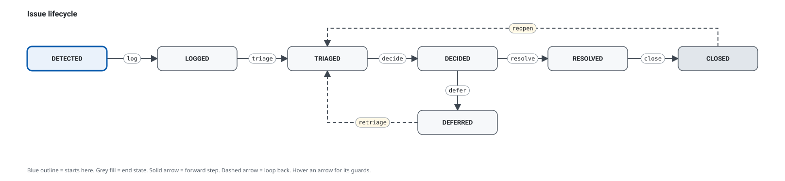
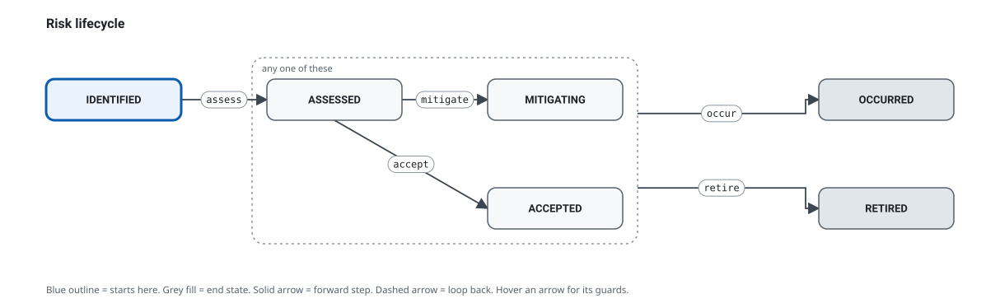
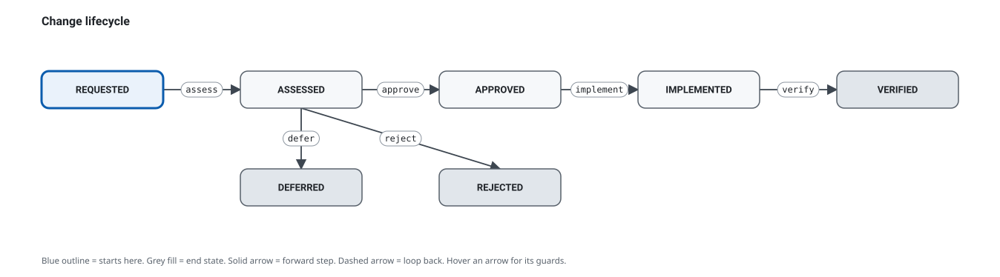
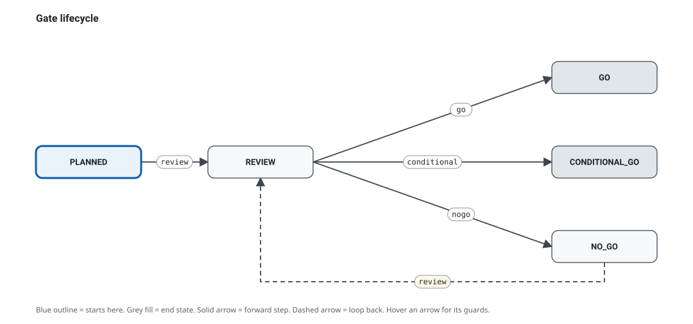

# Lifecycles

Generated from `pmf/data/lifecycles.json` by `tools/gen_lifecycles.py`. Do not edit by hand; edit the JSON and regenerate. A transition is refused unless every guard passes. Diagrams are drawn by `tools/gen_diagrams.py`; open `docs/diagrams/lifecycles.html` for all four with hover detail.

## Issue lifecycle

Register: `issues.csv`. Starts in `DETECTED`. Terminal: `CLOSED`.

| State | Meaning |
|---|---|
| `DETECTED` | Found at a gate, review or in the field. Not yet fully described. |
| `LOGGED` | In the register with one owner and a severity. Same day as detection. |
| `TRIAGED` | A decision record holds three options and a recommendation. |
| `DECIDED` | An option was chosen and recorded (signed for waive and defer). |
| `RESOLVED` | The chosen option was carried out and verified, or the waiver conditions are in place. |
| `CLOSED` | Management briefed (Sev 1 and 2) and a lesson captured. |
| `DEFERRED` | Option C chosen: carried as a known issue into a later release. |

| From | To | Command | Guards (all must pass) |
|---|---|---|---|
| `DETECTED` | `LOGGED` | `pmf issue log` | `has_required_fields`, `single_owner`, `valid_severity`, `valid_phase` |
| `LOGGED` | `TRIAGED` | `pmf issue triage` | `decision_record_has_three_options`, `decision_record_has_recommendation` |
| `TRIAGED` | `DECIDED` | `pmf issue decide` | `decision_chosen`, `decision_signed_if_waive_or_defer` |
| `DECIDED` | `RESOLVED` | `pmf issue resolve` | `option_is_fix_or_waive`, `verification_ref_present` |
| `DECIDED` | `DEFERRED` | `pmf issue defer` | `option_is_defer`, `customer_acceptance_if_customer_visible` |
| `RESOLVED` | `CLOSED` | `pmf issue close` | `brief_present_if_required`, `lesson_present` |
| `DEFERRED` | `TRIAGED` | `pmf issue retriage` | `reason_present` |
| `CLOSED` | `TRIAGED` | `pmf issue reopen` | `reason_present` |

Rules:

- Aging clock starts on the detected date, whatever state the issue is in.
- Escalated is computed: an issue in an open state for more than escalation.days is flagged.
- A Sev 1 or Sev 2 must appear in the current RAID snapshot (pmf raid).
- Changing severity is an event on the same state, not a transition; it is logged with a reason.

## Risk lifecycle

Register: `risks.csv`. Starts in `IDENTIFIED`. Terminal: `OCCURRED`, `RETIRED`.

| State | Meaning |
|---|---|
| `IDENTIFIED` | Logged. Not yet scored. |
| `ASSESSED` | Probability and impact scored (1 to 5 each); priority band known. |
| `MITIGATING` | An owner is running a mitigation plan. |
| `ACCEPTED` | A named approver accepted the exposure in writing. |
| `OCCURRED` | The triggering event happened. A linked issue was created. |
| `RETIRED` | No longer a threat (event passed or mitigated away). |

| From | To | Command | Guards (all must pass) |
|---|---|---|---|
| `IDENTIFIED` | `ASSESSED` | `pmf risk assess` | `single_owner`, `valid_probability`, `valid_impact` |
| `ASSESSED` | `MITIGATING` | `pmf risk mitigate` | `mitigation_present` |
| `ASSESSED` | `ACCEPTED` | `pmf risk accept` | `acceptor_named` |
| `ASSESSED` | `OCCURRED` | `pmf risk occur` | `linked_issue_exists` |
| `MITIGATING` | `OCCURRED` | `pmf risk occur` | `linked_issue_exists` |
| `ACCEPTED` | `OCCURRED` | `pmf risk occur` | `linked_issue_exists` |
| `MITIGATING` | `RETIRED` | `pmf risk retire` | `reason_present` |
| `ACCEPTED` | `RETIRED` | `pmf risk retire` | `reason_present` |
| `ASSESSED` | `RETIRED` | `pmf risk retire` | `reason_present` |

Rules:

- Risk score = probability x impact (1 to 25); the profile maps the score to a priority band and a review interval.
- Re-scoring is an event on the same state. A risk not re-scored within its band's review interval is flagged stale.
- A Critical or High risk cannot be ACCEPTED without a named approver and a note.

## Change request (ECR) lifecycle

Register: `changes.csv`. Starts in `REQUESTED`. Terminal: `REJECTED`, `DEFERRED`, `VERIFIED`.

| State | Meaning |
|---|---|
| `REQUESTED` | Asked for, logged as a candidate ECR. No work committed. |
| `ASSESSED` | Effort, cost, schedule and risk sized; tier computed. |
| `APPROVED` | Every approver required by the tier signed. Work may start. |
| `REJECTED` | Declined, with a rationale. |
| `DEFERRED` | Accepted but moved to a later release. |
| `IMPLEMENTED` | Work done; budget row and baseline updated. |
| `VERIFIED` | Result checked against the change request. |

| From | To | Command | Guards (all must pass) |
|---|---|---|---|
| `REQUESTED` | `ASSESSED` | `pmf change assess` | `sizing_present` |
| `ASSESSED` | `APPROVED` | `pmf change approve` | `all_tier_approvers_signed`, `decision_ref_present` |
| `ASSESSED` | `REJECTED` | `pmf change reject` | `reason_present` |
| `ASSESSED` | `DEFERRED` | `pmf change defer` | `reason_present` |
| `APPROVED` | `IMPLEMENTED` | `pmf change implement` | `budget_row_logged` |
| `IMPLEMENTED` | `VERIFIED` | `pmf change verify` | `verification_ref_present` |

Rules:

- No cost or schedule is committed before APPROVED. Work that starts earlier is a process failure, logged as an issue.
- Tier = the highest of the cost tier and the schedule tier; the profile lists the approvers per tier.
- When cumulative approved cost passes change_control.escalate_cumulative_pct of the baseline budget, pmf check warns that a formal re-baseline is due.

## Gate lifecycle

Register: `gates.csv`. Starts in `PLANNED`. Terminal: `GO`, `CONDITIONAL_GO`.

| State | Meaning |
|---|---|
| `PLANNED` | On the calendar with exit criteria. |
| `REVIEW` | Review meeting held or in progress. |
| `GO` | All exit criteria met. |
| `CONDITIONAL_GO` | Proceed; every unmet criterion has a signed waiver. |
| `NO_GO` | Do not proceed. An issue was logged for each unmet criterion. |

| From | To | Command | Guards (all must pass) |
|---|---|---|---|
| `PLANNED` | `REVIEW` | `pmf gate review` | `exit_criteria_listed` |
| `REVIEW` | `GO` | `pmf gate go` | `all_criteria_met`, `no_blocking_open_issues` |
| `REVIEW` | `CONDITIONAL_GO` | `pmf gate conditional` | `waiver_for_each_unmet_criterion`, `no_blocking_open_issues` |
| `REVIEW` | `NO_GO` | `pmf gate nogo` | `issue_logged_for_each_unmet_criterion` |
| `NO_GO` | `REVIEW` | `pmf gate review` | `reason_present` |

Rules:

- Planned gates and issue-triggered gates are listed apart; status reports never mix them.
- A gate may be added after kickoff only as type issue-triggered, with the issue that caused it.
- Gate on-time rate counts completed planned gates whose actual date is on or before the baseline date.

## Sev 1 overlay

Extra obligations while a Sev 1 is open.

- Exec notice sent the day it was detected
- Daily war-room update logged until RESOLVED
- Triage record with three options within the profile's Sev 1 cadence
- Management brief before CLOSED
- Retrospective one-pager after CLOSED

## Guard reference

| Guard | What it checks |
|---|---|
| `acceptor_named` | A named approver accepted the risk (and a note is given for Critical and High). |
| `all_criteria_met` | criteria_met covers every exit criterion. |
| `all_tier_approvers_signed` | Every approver the profile lists for the computed tier appears in approvers_signed. |
| `brief_present_if_required` | If the severity is in brief_required_for, briefs/B-NNN.md exists with all five sections filled. |
| `budget_row_logged` | The cost delta is reflected in budget.csv (a forecast update dated on or after approval). |
| `customer_acceptance_if_customer_visible` | If the record says Customer visible: yes, a customer acceptance reference is present. |
| `decision_chosen` | The record names the chosen option (A, B or C), who decided and when. |
| `decision_record_has_recommendation` | The record has a non-empty Recommendation line. |
| `decision_record_has_three_options` | decisions/DR-NNN.md exists and its Options table has rows A, B and C, each with schedule and cost filled. |
| `decision_ref_present` | decision_ref points to an existing decision record. |
| `decision_signed_if_waive_or_defer` | If the choice is B or C, the record says Signed: yes. |
| `exit_criteria_listed` | The gate has at least one exit criterion in the profile. |
| `has_required_fields` | id, title, description, phase, owner, severity and detected date are all filled. |
| `issue_logged_for_each_unmet_criterion` | An issue exists, with gate_found set to this gate, for each unmet criterion. |
| `lesson_present` | A one-line lesson is recorded. |
| `linked_issue_exists` | linked_issue points to an existing issue in the issue register. |
| `mitigation_present` | A mitigation plan is written. |
| `no_blocking_open_issues` | No open issue has a severity listed in the gate's requires_no_open_severity. |
| `option_is_defer` | The chosen option is C (defer). |
| `option_is_fix_or_waive` | The chosen option is A (fix now) or B (waive with conditions). |
| `reason_present` | A reason is given and logged in the event note. |
| `single_owner` | Exactly one named owner (no team names, no lists). |
| `sizing_present` | Effort, cost delta, schedule delta and risk note are filled. |
| `valid_impact` | Impact is a whole number in the profile's scale. |
| `valid_phase` | Phase is a phase id in the profile. |
| `valid_probability` | Probability is a whole number in the profile's scale. |
| `valid_severity` | Severity is one of the levels in the profile. |
| `verification_ref_present` | A verification reference is recorded (evidence for a fix, the waiver conditions for a waiver). |
| `waiver_for_each_unmet_criterion` | Every unmet criterion is covered by a waiver_refs decision record marked Signed: yes. |
